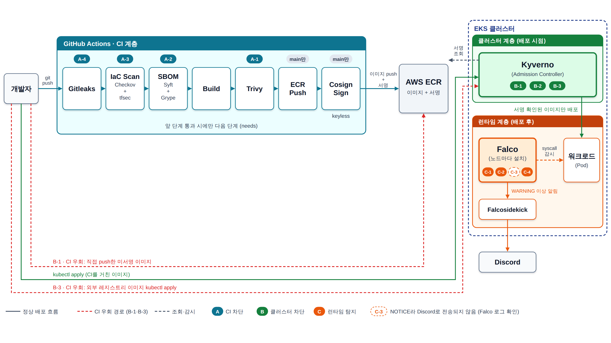

# 클라우드 네이티브 공급망·EKS 런타임 보안 검증

> 오픈소스만으로 어디까지 방어할 수 있고, 어디서부터 운영 검증이 필요한가를 11개 시나리오로 실증한 프로젝트
> 화이트햇 스쿨 러닝크루

## 1. 프로젝트 목적

- 1단계에서 공급망 공격 사례 8개를 분석했고, **단일 기술로는 공급망 공격을 막을 수 없다**는 결론을 얻었다.
- 이 저장소는 그 결론을 **CI → 클러스터 정책 → 런타임**의 세 계층으로 구현하고, 11개 시나리오로 **1단계의 예측과 실제 결과를 비교**한다.
- 핵심 질문은 "도구를 붙인 뒤 **무엇을 검증해야 실제 방어가 되는가**"이다. 결과는 한 문장으로 **"설정했다 ≠ 작동한다"** 로 요약된다(7번).

## 2. 아키텍처



*CI는 배포 전에 걸러내고, Kyverno는 배포 시점에 검증하고, Falco는 배포 후 행위를 탐지한다. 시나리오별 실제 결과는 7번 참고.*

아래 설명은 그림의 왼쪽(배포 전)에서 오른쪽(배포 후) 순서에 맞춘다.

- **배포 전 · CI 계층**: GitHub Actions 7개 Job이 `needs`로 직렬 연결된다. 앞 5개(Gitleaks → Checkov+tfsec → SBOM Diff → Build → Trivy)가 비밀값, IaC, 의존성, 이미지 취약점을 걸러 내고, 모두 통과한 `main` 브랜치의 `push`·수동 실행에서만 `Push Image to ECR`와 `Cosign Keyless Sign`이 이미지를 올리고 서명한다.
- **CI → 클러스터 연결 고리**: CI의 산출물은 ECR 이미지(커밋 SHA 태그)와 그 digest에 붙은 Cosign 서명이다. 클러스터는 이 둘을 두 정책으로 확인하고 위반하면 배포를 거부한다. `restrict-image-registries`는 팀원 네임스페이스(`ns-*`)에서 ECR 이미지만 허용하고, `verify-image-signature`는 서명이 있는지, 서명 신원이 `ci-pipeline.yml`을 `main` 또는 `feat/ci-pipeline`에서 실행한 것인지 검증한다. 서명 검증은 ECR 이미지에만 적용되므로, ECR 밖의 외부 레지스트리 이미지는 `restrict-image-registries`가 막는다. 서명 단계가 만드는 신원과 검증 정책에 적힌 신원이 같은 값이어야 두 계층이 맞물린다.
- **배포 시점 · 클러스터 정책 계층(Kyverno)**: 위 두 정책 외에 `disallow-latest-tag`, `disallow-root-user`가 배포 방식을 제한한다. CI는 ECR에 SHA 태그로만 push하므로 CI를 통과한 이미지는 latest 금지 정책과 충돌하지 않는다.
- **배포 후 · 런타임 계층(Falco)**: 서명과 정책을 모두 통과한 워크로드가 실행 중에 하는 행동은 CI와 정책이 볼 수 없다. 그룹 C 시나리오(C-1~C-4)를 Falco가 탐지한다. 탐지 결과는 Falcosidekick을 거쳐 WARNING 이상만 Discord로 전송되며, NOTICE인 C-3은 Discord로 가지 않고 Falco 로그에서 확인한다. Falco가 설치되는 `falco` 네임스페이스는 `disallow-root-user`에 대한 PolicyException으로 예외 처리되어 있다.

**시나리오 매핑**: 11개 시나리오는 **최종 방어 지점** 기준으로 세 계층에 대응한다.

| 그룹 | 계층 | 시나리오 → 대응 지점 |
| --- | --- | --- |
| A (4건) | CI, 배포 전 | A-1 취약 라이브러리 → Trivy(Job 5) · A-2 락파일 미대응 의존성 → SBOM Diff(Job 3) · A-3 IaC 설정 오류 → Checkov+tfsec(Job 2) · A-4 자격증명 하드코딩, COPY 후 삭제한 이미지 → Gitleaks(Job 1)와 이미지 레이어 추출 |
| B (3건) | 클러스터, 배포 시점 | B-1 미서명 ECR 이미지 → `verify-image-signature`(ECR 이미지에만 적용) · B-2 latest 태그·root 실행 → `disallow-latest-tag`·`disallow-root-user` · B-3 CI 우회 직접 배포(ECR 밖 외부 이미지) → `restrict-image-registries`(`ns-*`에만 적용). 처음에는 서명 정책이 막을 것으로 예상했으나 서명 검증이 ECR 이미지에만 적용되어 통과했고, 이 정책으로 보완했다(예측 불일치) |
| C (4건) | 런타임, 배포 후 | C-1 크립토마이닝 · C-2 로그 삭제·백도어 계정·루트킷 · C-3 장시간 대기 후 외부 연결 · C-4 자격증명 읽기·외부 전송 → 모두 Falco가 탐지 |

## 3. 사전 요구사항

### 3-1. CI·AWS

워크플로는 AWS 액세스 키를 쓰지 않는다. GitHub Actions가 발급받은 OIDC 토큰으로 IAM 역할을 임시로 맡아(assume) ECR에 접근한다.

**AWS 구성**

| 항목 | 값 | 비고 |
| --- | --- | --- |
| IAM 역할 | `arn:aws:iam::<AWS_ACCOUNT_ID>:role/GitHubActionsECRRole` | `ecr-push`, `cosign-sign` Job이 `aws-actions/configure-aws-credentials@v4`로 assume |
| 토큰 발급자(issuer) | `https://token.actions.githubusercontent.com` | Kyverno 서명 검증의 issuer와 같은 값 |
| IAM OIDC 공급자 | `token.actions.githubusercontent.com` 등록됨 | 계정에 GitHub OIDC 공급자가 등록되어 있다 |
| 신뢰 정책 | `sts:AssumeRoleWithWebIdentity` 허용. 조건: `aud` = `sts.amazonaws.com`, `sub` = 이 저장소의 `refs/heads/main`(`StringEquals`) | `main` 브랜치에서 실행된 워크플로만 역할을 assume할 수 있다. `sub` 값은 조직·저장소 이름 뒤에 `@숫자`가 붙는 형식이다 |
| 권한 정책 | AWS 관리형 `AmazonEC2ContainerRegistryPowerUser` 1개, 인라인 정책 없음 | 로그인, 레이어 업로드, `PutImage` 등 ECR push·pull·조회 16개 액션(조회 기준). 리소스는 `*`라 저장소 단위로 제한되어 있지 않다. 이미지 삭제(`ecr:BatchDeleteImage`)는 포함하지 않는다 |
| 리전 | `ap-northeast-2` | |
| ECR 저장소 | `whs4-demo-app` | `<AWS_ACCOUNT_ID>.dkr.ecr.ap-northeast-2.amazonaws.com/whs4-demo-app` |
| 이미지 태그 | 커밋 SHA(`github.sha`) | `latest`는 ECR에 올리지 않는다. 서명은 digest 기준 |
| ECR 설정 | 태그 가변(`MUTABLE`), push 시 스캔 켜짐(`scanOnPush: true`), 암호화 `AES256`, 수명주기 정책 없음 | 태그 불변성이 꺼져 있어 같은 SHA 태그를 덮어쓸 수 있다(같은 커밋을 수동 실행으로 다시 올리면 이미지 시각이 갱신되는 것을 확인했다). 수명주기 정책이 없으므로 이미지 정리는 수동이다 |

**`id-token` 권한(Job별)**

| 범위 | `permissions` | 필요한 이유 |
| --- | --- | --- |
| 워크플로 기본값 | `contents: read` | 체크아웃만 가능. OIDC 토큰은 발급되지 않는다 |
| Job 1~5 (Gitleaks ~ Trivy) | 기본값 상속 | AWS·서명 접근이 필요 없다 |
| `ecr-push` | `contents: read`, `id-token: write` | OIDC 토큰으로 AWS 역할을 assume해 ECR에 push |
| `cosign-sign` | `contents: read`, `id-token: write` | ① ECR 로그인을 위한 AWS 역할 assume ② Cosign keyless 서명에 쓰는 OIDC 신원 토큰 |

`id-token: write`는 이 두 Job에만 Job 단위로 부여하고, 두 Job 모두 `if: github.event_name != 'pull_request'`로 PR 실행에서는 돌지 않는다.

**Cosign 서명 신원** (Kyverno `verify-image-signature`에 등록된 값과 일치)

- subject: `https://github.com/WHS4-learning-crew/whitehat-supply-chain-security/.github/workflows/ci-pipeline.yml@refs/heads/main` 또는 `...@refs/heads/feat/ci-pipeline`
- issuer: `https://token.actions.githubusercontent.com`
- 현재 허용 주체는 `main`이다. AWS 역할의 신뢰 정책은 `main`만 허용하며, ECR push와 서명이 가능한 실행은 `main`뿐이다. `feat/ci-pipeline`은 과거 이미지(대조군)를 위한 임시 허용으로 Kyverno 정책에 남아 있고, 발표 후 대조군 이미지를 `main` 서명 이미지로 교체한 다음 Kyverno 정책과 워크플로의 `on.push.branches`에서 함께 제거할 예정이다.

### 3-2. 클러스터·도구

| 항목 | 내용 | 비고 |
| --- | --- | --- |
| 클러스터 | Amazon EKS `whitehat-eks`, Kubernetes v1.34, 리전 `ap-northeast-2` | 팀원 네임스페이스는 `ns-<이름>` 형식이다. 정책의 적용 범위가 `ns-*`이다 |
| 로컬 도구 | `aws`(CLI), `kubectl`, `eksctl`, `helm`, `cosign`, `crane`, `rekor-cli`, `jq`, `gitleaks`, Docker | macOS 예: `brew install awscli kubectl eksctl helm cosign crane rekor-cli jq gitleaks`, Docker Desktop은 별도 설치 |
| 정책 엔진 | Kyverno **v1.19.0**(Helm 차트 `kyverno-3.9.0`). `ClusterPolicy`, `ImageValidatingPolicy`, `PolicyException`을 쓴다. 예외 기능은 기본이 꺼져 있어 `features.policyExceptions.enabled=true`로 켜고 `namespace=falco`로 범위를 제한했다 | 설치 방법은 [사전 구성](docs/prerequisites.md)에 있다 |
| 스토리지 | EBS CSI 드라이버(`aws-ebs-csi-driver` 애드온)와 암호화한 `gp3`를 기본 StorageClass로 둔다 | EKS 1.34에는 기본으로 없다. 없으면 Falcosidekick UI의 Redis PVC가 `Pending`에 머문다([사전 구성](docs/prerequisites.md)) |
| 런타임 탐지 | Falco(Helm 차트 `9.2.0` 고정)와 Falcosidekick(Discord 알림) | `scripts/04-install-falco.sh`가 설치한다 |
| 필요 권한 | 스크립트마다 다르다. `02-setup-irsa.sh`는 IAM 쓰기를 포함해 **관리자급**이 필요하고(스크립트 머리 주석 참고), 정책 관리에는 `kyverno.io`, `policies.kyverno.io`, `wgpolicyk8s.io` 세 API 그룹의 권한이, Falco 설치에는 `falco` 네임스페이스 범위의 권한이 필요하다 | 비관리자는 `02`의 1단계에서 멈춘다(교차 검증 결과) |

**겪은 함정**: 권한 오류처럼 보인 문제 중 하나는 클러스터에 EBS CSI 드라이버가 없는 인프라 누락이었다(권한 요청 12건 중 1건). **권한을 넓히기 전에 원인부터 확인한다.**

## 4. 빠른 시작

스크립트는 `scripts/`에 있다. 각 단계의 소요 시간과 막힌 지점은 교차 검증 결과(8번)에 있다.

| 순서 | 스크립트 | 하는 일 | 성공 기준 |
| --- | --- | --- | --- |
| 1 | (3-1 참고) | GitHub OIDC 역할과 ECR 구성 | `main`에서 수동 실행했을 때 7개 Job이 모두 초록 |
| 2 | `scripts/05-apply-kyverno-policies.sh <네임스페이스>` | 정책 5개(`policies/`)를 한 번에 적용 | 정책이 Ready, 아래 4단계 통과. **실행 전에 `kubectl diff -f policies/<파일>.yaml`로 변경이 없는지 확인한다** **선행 조건**: Kyverno가 설치되어 있어야 하고([사전 구성](docs/prerequisites.md)의 3번), 클러스터 범위 정책을 적용할 권한이 필요하다(일반 팀원 권한으로는 첫 단계에서 멈춘다) |
| 3 | `scripts/04-install-falco.sh` | Falco와 Falcosidekick 설치 | `falco` 네임스페이스의 파드가 Running (필요: `DISCORD_WEBHOOK_URL` 환경변수. 없으면 `[1/5]`에서 안내하고 멈춘다) |
| 4 | `scripts/check-policy-health.sh` | 정책이 **실제로 거부하는지** 확인 | "정책 점검 통과 — 모든 항목 정상" |
| 5 | `scripts/07-cosign-sign-verify.sh <이미지>:<태그>` | 서명과 검증 신원 확인 | 문서의 종료 코드 표와 일치 |
| 선택 | `scripts/02-setup-irsa.sh` | Secrets Manager용 IRSA 구성 | 5단계는 정책 환경에서 `VERIFY=false`가 필요할 수 있다(머리 주석 참고) |

스크립트 번호는 실행 순서를 뜻하는 이름 규칙에서 왔다. **01(클러스터 생성), 03(Kyverno 설치), 06(CI용 AWS 구성)에 해당하는 단계는 스크립트로 만들지 않았다.** 팀이 했던 방법과 현재 상태는 [사전 구성](docs/prerequisites.md)에 있고, 위 스크립트는 그 단계들이 되어 있다고 가정한다.

## 5. 계층별 가이드와 스크립트

### 5-1. CI 계층

**트리거 3가지**

- `push`: `main`, `feat/ci-pipeline`(임시, 발표 후 `on.push.branches`에서 제거 예정)
- `pull_request`: 대상 브랜치 `main`
- `workflow_dispatch`: 수동 실행

**7개 Job의 순서와 역할** (`needs`로 직렬 연결, 앞 Job이 실패하면 뒤 Job은 실행되지 않는다)

| 순서 | Job | 역할 | 실행 조건 |
| --- | --- | --- | --- |
| 1 | Gitleaks Secret Scan | gitleaks v8.21.2로 전체 커밋 이력의 비밀값 탐지(`.gitleaks.toml`) | 모든 트리거 |
| 2 | Checkov + tfsec | Dockerfile·Kubernetes·GitHub Actions는 Checkov로, `infra-rbac/` Terraform은 tfsec(HIGH 이상)으로 검사 | 모든 트리거 |
| 3 | SBOM Diff and Risk Scan | 이전 커밋 대비 SBOM(CycloneDX) 비교, 신규 패키지 위험 점수화(임계값 60), Grype 리포트(차단하지 않음) | 모든 트리거 |
| 4 | Build Docker Image | `app/Dockerfile` 빌드, 이미지를 아티팩트로 다음 Job에 전달 | 모든 트리거 |
| 5 | Trivy Image Scan | CRITICAL·HIGH 스캔. 패치 가능한 CRITICAL 고유 CVE가 있으면 실패, HIGH는 경고만 | 모든 트리거 |
| 6 | Push Image to ECR | 커밋 SHA 태그로 ECR push | PR 제외. 신뢰 정책상 `main` 실행만 AWS 인증 통과 |
| 7 | Cosign Keyless Sign | ECR 이미지 digest에 keyless 서명 | PR 제외. 신뢰 정책상 `main` 실행만 AWS 인증 통과 |

**PR에서 `Push Image to ECR`와 `Cosign Keyless Sign`이 건너뛰어지는 것은 정상이다.** 일부러 막아 둔 것이다.

- 두 Job에 `if: github.event_name != 'pull_request'` 조건이 있고, `id-token: write`도 이 두 Job에만 Job 단위로 부여한다.
- AWS 역할의 신뢰 정책도 `main` 브랜치 실행만 허용하므로, PR 실행은 조건이 없더라도 역할을 맡을 수 없다. `if:` 조건을 지운 시험 PR에서도 `Push Image to ECR`가 AWS의 역할 맡기 거부로 실패하는 것을 확인했다.
- 검증이 끝나지 않은 PR 코드가 ECR에 이미지를 올리거나 서명하지 못하게 하기 위해서다. Kyverno는 `main`·`feat/ci-pipeline` 실행의 서명만 신뢰하므로, PR에서 만든 서명은 신뢰 기준과도 맞지 않는다.
- GitHub 화면에서 두 Job이 Skipped로 표시되어도 실패가 아니며, PR에서는 Job 1~5의 결과로 판단한다. 다만 **Job 1~5의 초록을 병합 기준으로 삼는 것은 팀의 약속**이다. 이 저장소(비공개, 무료 요금제)에서는 브랜치 보호 규칙을 만들 수 있으나 강제되지 않는 것을 시험으로 확인했다.

**로컬 재현**: 레포 루트에서 아래를 실행하면 이미지 빌드, `/health` 응답, 비-root 실행(`whoami`)을 한 번에 확인한다. 사전 조건과 단계별 설명은 [docs/run-build-verify.md](docs/run-build-verify.md)에 있다.

```bash
bash scripts/run-build-verify.sh
```

호스트 3000번 포트가 사용 중이면 `HOST_PORT=3001 bash scripts/run-build-verify.sh`로 바꿔 실행한다.

**오버헤드**: Job 소요 시간의 합계는 5회 평균 **256.4초**(약 4분 16초), 범위 241~280초이다. **기준은 Job 합계이며 Job 사이의 스케줄링 대기는 포함하지 않는다.** 콜드(Trivy DB 캐시 없음)는 280초, 웜 평균은 250.5초이고 그 차이의 대부분(25초)은 Trivy DB 다운로드이다. Job별 표와 원본 데이터는 [docs/overhead.md](docs/overhead.md)에 있다.

### 5-2. 클러스터 정책 계층

정책 5개의 **원본은 `policies/`**이다. 클러스터를 직접 `kubectl patch`로 바꾸지 않고 **파일을 고쳐서 적용**한다.

| 객체 | 종류 | 역할 | 모드 |
| --- | --- | --- | --- |
| `verify-image-signature` | ImageValidatingPolicy | ECR 이미지의 Cosign 서명과 서명 신원 검증. 서명이 없거나 신원이 다르면 거부 | ECR 이미지에만 적용 |
| `restrict-image-registries` | ClusterPolicy | `ns-*`에서 ECR 이미지만 허용 | Enforce |
| `disallow-latest-tag` | ClusterPolicy | `latest` 태그 금지 | Enforce |
| `disallow-root-user` | ClusterPolicy | root 실행 금지 | Enforce |
| `falco-root-exception` | PolicyException | `falco` 네임스페이스의 root 예외 | |

**운영 원칙** (이번 프로젝트에서 겪은 문제에서 나왔다)

- **적용 전에 `kubectl diff -f policies/<파일>.yaml`** 을 실행한다. 종료 코드 0이면 바뀌는 것이 없고, 1이면 차이 줄을 읽는다. 집행 모드가 `Enforce`에서 `Audit`으로 바뀌는 변경이 적용 전에 그대로 보인다.
- **복구도 원본 파일을 적용**하는 방식으로 한다. `patch`는 마지막 적용 기록을 갱신하지 않아 원본과의 어긋남을 새로 만든다.
- **`READY: True`는 정책이 실제로 거부한다는 뜻이 아니다.** `scripts/check-policy-health.sh`가 웹훅 등록, 컨트롤러 오류 로그, 서버 dry-run으로 미서명 이미지와 외부 이미지는 거부되고 정상 이미지는 통과하는지 확인한다(파드는 만들지 않는다). 정상 이미지를 바꾸려면 `SIGNED_IMAGE`에 ECR 이미지를 지정한다.
- 정책 YAML의 **집행 모드는 CI가 판단하지 않는다.** 원본이 `Audit`이어도 CI는 초록이다. 그래서 위 점검과 사람의 확인이 따로 필요하다.

### 5-3. 런타임 계층

| 룰 | 탐지 대상 | 우선순위 | 검증한 곳 |
| --- | --- | --- | --- |
| `Suspicious Cryptomining Activity Detected` | 크립토마이닝 | CRITICAL | C-1 |
| `Log or History Tampering` | 로그·히스토리 삭제 | WARNING | C-2 |
| `Suspicious User Account Creation` | 백도어 계정 생성 | CRITICAL | C-2 |
| `Kernel Module Load Attempt` | 커널 모듈 로드(루트킷) | CRITICAL | C-2 |
| `Network Scanning Tool Launched` | TeamTNT 확산 단계의 스캐닝 도구 실행 | WARNING | 2단계 로컬 PoC(3단계 시나리오에는 포함하지 않음) |
| `Outbound Connection From Dormant Beacon Pod` | 장시간 대기 후 시작되는 외부 연결 | NOTICE (Discord로 가지 않음) | C-3 |
| `WHS4 Secret File Sent To Network` | 시크릿 파일 경로를 네트워크 도구의 인자로 전달 | CRITICAL | C-4 |
| `WHS4 Read Other Process Environment` | 다른 프로세스의 환경변수(`/proc/<pid>/environ`) 읽기 | WARNING | C-4 |
| `WHS4 Memory Dump Tool In Container` | 메모리 덤프 도구 실행 | CRITICAL | 재현하지 못함(도구 없음) |

- 커스텀 룰은 `falco-rules/values.yaml`의 `customRules`에 있다. 룰 이름 위의 표는 룰별로 어느 시나리오에서 검증했는지를 보여 준다. C-4 룰 세 개에는 `scenario_c4` 태그가 있다.
- **기본 룰 조정**: 기본 룰을 지우거나 새로 쓰지 않고, 기존 조건 뒤에 "이것은 제외한다"는 조건만 덧붙였다(`override: condition: append`). 오탐을 줄이기 위한 두 가지이다. `Contact K8S API Server From Container`는 `kyverno` 네임스페이스를 제외한다(Kyverno 컨트롤러가 API 서버에 정상 접속하는 것이 오탐으로 잡힘). `Drop and execute new binary in container`는 컨테이너 런타임 프로세스(`containerd`, `containerd-shim`, `runc`)와, 커스텀 룰이 따로 탐지하는 `xmrig`, `nmap`, `masscan` 이름의 프로세스를 제외한다(중복 탐지를 막기 위한 `known_drop_and_execute_activities` 매크로 재정의). 네임스페이스와 프로세스 이름 단위의 제외는 그 범위가 침해되면 사각지대가 된다.
- 알림은 Falcosidekick을 거쳐 **WARNING 이상만 Discord**로 간다. **탐지와 알림은 별개**이다. NOTICE는 탐지되어도 알림이 없다.
- **C-3**: Falco의 기본 `outbound` 매크로가 사설 IP 대역 연결을 제외해, 설계한 환경에서 1차 실행은 미탐이었다. 사설 IP 제외 부분만 뺀 연결 조건을 직접 써서 2차 실행에서 탐지했다. 룰은 휴면 여부를 판별하지 않는다.
- **C-4의 사각지대**: 룰 A는 시크릿 경로와 목적지가 **한 프로세스의 인자에 함께 있을 때만** 잡는다. `cat 파일 | curl -d @-`처럼 파이프로 우회하면 탐지하지 못한다. 메모리 덤프 도구는 컨테이너에 없고 특권이 막혀 재현하지 못했다.
- **설치 계정 권한**: Falco 설치 계정은 `falco` 네임스페이스 범위 권한만 가진다. 릴리스가 관리하는 리소스가 모두 이 네임스페이스 안에 있어서 클러스터 전체의 Secret 읽기·exec 권한은 회수했고, 업그레이드는 그대로 동작한다.
- **설치 스크립트의 한계**: 새 클러스터의 최초 설치 경로(`--create-namespace`)는 검증하지 않았다.

## 6. 시나리오 재현 방법

| 그룹 | 시나리오 | 재현 방법 | 스크립트·파일 | 기대 결과 |
| --- | --- | --- | --- | --- |
| A | A-1 취약 라이브러리(Log4Shell 유형) | `pom.xml`에 `log4j-core`를 선언하지 않고 `spring-boot-starter-log4j2`만 쓴 Java 이미지를 만들면 `log4j-core` 2.14.1이 fat jar 안으로 들어온다. 이 이미지를 CI의 Trivy Job으로 스캔하고, 패치된 대조군과 비교한다 | 별도 Java 검증 워크플로 `scenario-a1-test.yml`과 `test-scenarios/a1-log4shell/`(테스트 브랜치 `test/a1-trivy-block`), 로컬에서는 `scripts/run-trivy-scan.sh <이미지>` | 취약 버전은 Log4j 관련 CVE 3건으로 실패(차단), 대조군은 통과. Log4Shell 공격 자체를 재현한 것은 아니다 |
| A | A-2 락파일 미대응 의존성(axios 유형) | 락파일과 맞지 않는 새 의존성으로 SBOM 게이트를 실행 | `scripts/run-sbom-gate.sh`, `scripts/sbom_gate.py` | 새 의존성을 전부 막지 않고 **위험도 60점 이상이면 차단**(설치 스크립트 40점, 게시 30일 미만 25점 등을 합산) |
| A | A-3 IaC 설정 오류(Notepad++ 유형) | 업데이트 매니페스트 저장소를 S3로 가정하고, 공개 정책 차단 옵션(`block_public_policy`)을 끈 Terraform을 `infra-rbac/`에 두고 IaC 검사를 실행 | `scripts/run-iac-scan.sh`, 테스트 코드 `infra-rbac/a3-manifest-access.tf`(테스트 브랜치) | tfsec `aws-s3-block-public-policy`(HIGH)로 차단, `true`로 수정하면 통과. 실제 사건의 침입 경로를 재현한 것은 아니다 |
| A | A-4 자격증명 하드코딩, 삭제한 파일의 레이어 잔존(Codecov 유형) | DB 커넥션 스트링 커밋 후 gitleaks, `COPY` 후 `RUN rm`한 이미지를 빌드하고, 컨테이너에서는 보이지 않는 파일이 **이미지 레이어에는 남아 있는지** `docker save`로 확인 | CI Job 1(`.gitleaks.toml`). 레이어는 `docker save <이미지> -o x.tar`, `tar -xf x.tar -C extracted`로 풀어 각 레이어에서 파일을 검색한다 | 4초 만에 차단, 취약 구성은 레이어에서 복구되고 멀티스테이지는 검출되지 않음 |
| B | B-1 미서명 ECR 이미지 | `ns-*`에 서명이 없는 ECR 이미지를 배포 | `scripts/check-policy-health.sh`, `scripts/07-cosign-sign-verify.sh` | 거부 |
| B | B-2 latest 태그, root 실행 | `latest` 태그 이미지 또는 root로 실행되는 파드를 배포 | 정책 `disallow-latest-tag`, `disallow-root-user` | 거부 |
| B | B-3 CI 우회 직접 배포(외부 레지스트리) | `ns-*`에 Docker Hub 이미지(`busybox`)를 배포한다. 서명 검증은 ECR 이미지에만 적용되므로 외부 이미지는 거치지 않는다 | 정책 `restrict-image-registries` | Audit 모드에서는 통과, **Enforce 전환 후에는 거부**. ECR의 정상 이미지는 영향이 없다 |
| C | C-1 크립토마이닝 | 컨테이너 안에서 채굴기처럼 보이는 더미 스크립트를 만들어 실행: `echo '#!/bin/sh' > /tmp/xmrig && echo 'sleep 3' >> /tmp/xmrig && chmod +x /tmp/xmrig && /tmp/xmrig` | `falco-rules/values.yaml`의 `Suspicious Cryptomining Activity Detected` | CRITICAL로 탐지되고 Discord 알림이 같은 분 안에 도착한다. 실제 악성코드가 아닌 더미이며 이름을 바꾼 채굴기는 확인하지 못했다 |
| C | C-2 로그 삭제·백도어 계정·커널 모듈(루트킷) | 컨테이너 안에서 세 가지를 실행: ① `/tmp/history -c` ② `/tmp/useradd`(위장 스크립트) ③ `touch /tmp/fake.ko && insmod /tmp/fake.ko`. **`history -c`는 셸 내장 명령이라 Falco가 프로세스로 보지 못해서, `history`라는 이름의 실행 파일을 만들어 실행했다** | `falco-rules/values.yaml`의 `Log or History Tampering`, `Suspicious User Account Creation`, `Kernel Module Load Attempt` | 세 행위 모두 Falco 이벤트와 같은 분 안에 Discord 알림이 도착한다. 다만 룰이 프로세스 실행을 기준으로 해서 진짜 셸 내장 `history -c`와 `>` 리다이렉션은 보지 못한다 |
| C | C-3 장시간 대기 후 외부 연결 | 설계한 환경(`ns-kimseoyeon`, 지정 라벨 파드)에서 대기 후 외부로 연결 | `falco-rules/values.yaml`의 `Outbound Connection From Dormant Beacon Pod` | 1차 미탐, 룰 수정 후 2차 탐지. NOTICE라 Discord 알림 없음 |
| C | C-4 시크릿 파일 외부 전송 | 시크릿을 마운트한 파드에서 `curl -d @파일`과 파이프 우회를 비교 | `falco-rules/values.yaml`의 `WHS4 Secret File Sent To Network` 등 3개 | 직접 전송은 CRITICAL로 탐지, 파이프 우회는 미탐 |

## 7. 결과 요약

11개 시나리오 중 **1단계 예측과 일치 8, 불일치 3**(B-1, B-3, C-3)이다. 불일치에서 얻은 것이 일치보다 크다.

| 시나리오 | 결과 | 1단계 예측 |
| --- | --- | --- |
| A-1 | 차단(간접 의존성 포함) | 일치 |
| A-2 | 차단(락파일 불일치), 대조군 통과 | 일치 |
| A-3 | 차단(tfsec HIGH), 수정 대조군 통과 | 일치 |
| A-4 | 차단. 발견: gitleaks 예외 규칙이 실제 호스트명까지 걸러 미탐이었고(위치 기반 매칭으로 수정), CI가 실패해도 병합 버튼은 활성이었다 | 일치 |
| B-1 | 처음에는 미서명 이미지가 통과(webhook `timeoutSeconds` 60이 상한 30을 넘어 미등록). 30으로 수정한 뒤 거부 | **불일치 → 해결** |
| B-2 | 차단 | 일치 |
| B-3 | ECR은 막지만 외부 레지스트리는 통과(서명 검증이 ECR에만 적용). 허용 레지스트리 정책도 처음에는 Audit이라 통과했고, Enforce로 전환한 뒤 거부 | **불일치 → 대응** |
| C-1, C-2 | 네 행위(크립토마이닝, 로그 삭제, 백도어 계정, 커널 모듈)를 모두 탐지. 다만 셸 내장 명령(`history -c`)과 리다이렉션은 프로세스 실행 기준 룰이 보지 못했다 | 일치 |
| C-3 | 설계 환경의 1차 실행은 미탐(기본 매크로가 사설 IP 제외). 룰 수정 후 2차 탐지 | **불일치** |
| C-4 | 직접 전송은 탐지, 파이프 우회는 미탐(사각지대) | 일치 |

**관통 주제: "설정했다 ≠ 작동한다"** 를 다섯 축으로 정리한다.

| 축 | 사례 |
| --- | --- |
| 작동 검증 | B-1: 정책은 Ready인데 실제로는 미집행. 이후 모든 정책이 Ready인데 하나가 `Enforce`에서 `Audit`으로 되돌아간 일을 점검 스크립트가 잡았다. Falco에서도 룰 한 줄의 컴파일 오류가 Falco 전체를 `CrashLoopBackOff`로 만들었고 `schema validation: ok`는 이를 알려 주지 않았다 |
| 설정 범위 | B-3: 서명 검증이 ECR에만 적용. 서명 신원이 `feat/ci-pipeline`에 고정. PR 실행도 ECR에 이미지를 올리고 서명을 받고 있었다 |
| 예외 승인 | waiver 절차와 `ignore-unfixed`의 충돌, 승인 없이도 예외를 등록할 수 있는 구조 |
| 권한 강제 | CI가 막아도 병합 버튼은 활성. 보호 규칙은 비공개 저장소의 무료 요금제에서 강제되지 않음. Falco 설치 계정의 과잉 권한 회수 |
| 탐지 조건 | C-3 기본 매크로의 사설 IP 제외, C-4 파이프 우회, 탐지와 알림은 별개 |

## 8. 한계

- 단일 데모 앱, 단일 클러스터, 더미 공격, 시나리오당 표본 1회
- 도구의 기본값과 **플랫폼 제약**: 비공개 저장소의 무료 요금제에서는 브랜치 보호 규칙이 강제되지 않는다. 그래서 **예외 승인(`.trivyignore`)도 규칙으로 막을 수 없고** 팀의 약속에 의존한다.
- 일부 증거는 텍스트 로그 없이 캡처뿐이다. 9/25의 C-1·C-2·C-4는 Falco 로그를 캡처로만 보관하고(클러스터의 원본 로그는 10/3의 Falco 재시작으로 사라졌다), C-3의 1차 실행은 Falco 쪽 로그가 남지 않았다.
- `02-setup-irsa.sh`는 IAM 쓰기 권한이 필요해 **비관리자는 1단계에서 멈춘다**(교차 검증으로 확인)
- **탐지의 사각지대**: C-4의 파이프 우회와 메모리 덤프(도구가 없어 재현하지 못함)는 탐지하지 못했고, C-2의 룰은 프로세스 실행을 기준으로 해서 `history -c` 같은 셸 내장 명령과 `>` 리다이렉션을 보지 못한다. 크립토마이닝은 더미 페이로드로 행위 패턴만 재현했으며, 이름을 바꾼 실제 채굴기에 대한 탐지율은 말할 수 없다.
- **룰 검증의 공백**: Falco 룰 한 줄의 컴파일 오류가 Falco 전체를 기동 불능으로 만들었고 `schema validation: ok`는 이를 알려 주지 않았다. CI는 Falco 룰 문법까지 검사하지 않아, 배포 후 파드가 `Running`을 유지하고 재시작이 0회인지 확인한다.
- Falco 설치 스크립트의 최초 설치 경로(`--create-namespace`)는 검증하지 않았다.
- CloudTrail은 최근 50건만 조회했다. 과거 전체에 외부 접근이 없었다는 보장은 아니다
- **재현성**: 교차 검증 8쌍 중 5쌍(로컬 CI 4개, 서명 검증 1개)은 문서만으로 끝까지 실행했고(4초~2분 36초), 클러스터 쪽 3개(`02`, `04`, `05`)는 일반 팀원 권한으로 끝까지 실행하지 못했다. 5쌍이 문서에 없던 전제조건을 기록했다.
- **스캔 결과의 시점 의존**: 베이스 이미지 태그, 빌드 중 패키지 갱신, trivy 버전을 고정하지 않아 같은 커밋이라도 실행 시점에 따라 CVE 수가 달라질 수 있다.
- **계정 ID**: `policies/`와 `ci-pipeline.yml`에는 AWS 계정 ID가 들어 있어 자신의 계정으로 바꿔야 한다.
- **사전 구성**: 클러스터, EBS CSI, Kyverno 설치, CI용 AWS 구성은 스크립트가 아니라 문서로만 남아 있어 사람이 직접 따라 해야 한다.

## 9. 정리·삭제

비용이 계속 발생하므로 발표 후 아래 순서로 정리한다.

1. **증거 아카이브**: 로그와 캡처를 백업한 뒤에 지운다.
2. **ECR 이미지**: `whs4-demo-app`의 이미지와 서명, PR 실행이 올린 이미지를 정리한다. 이미지 삭제 권한(`ecr:BatchDeleteImage`)은 CI 역할에 없으므로 관리자 권한으로 한다.
3. **IAM**: `GitHubActionsECRRole`, IRSA 역할과 정책(`whs4-<네임스페이스>-secrets-reader` 계열), 발표 후 불필요해지는 OIDC 공급자를 확인한다.
4. **Secrets Manager**: 실습용 시크릿을 삭제한다.
5. **EKS 클러스터와 노드 그룹**: 마지막에 삭제한다. `eksctl delete cluster --name whitehat-eks --region ap-northeast-2`
6. **확인**: 조회 명령으로 남은 리소스와 청구 항목이 없는지 한 번 더 본다. CloudFormation에 `eksctl-whitehat-eks-…` 스택이 남아 있지 않은지도 본다([사전 구성](docs/prerequisites.md)의 확인 명령).

정리하기 전에 `aws` 조회 명령으로 남은 리소스 목록을 한 번 더 확인하고, 위 목록을 그 결과에 맞게 보정한다.
